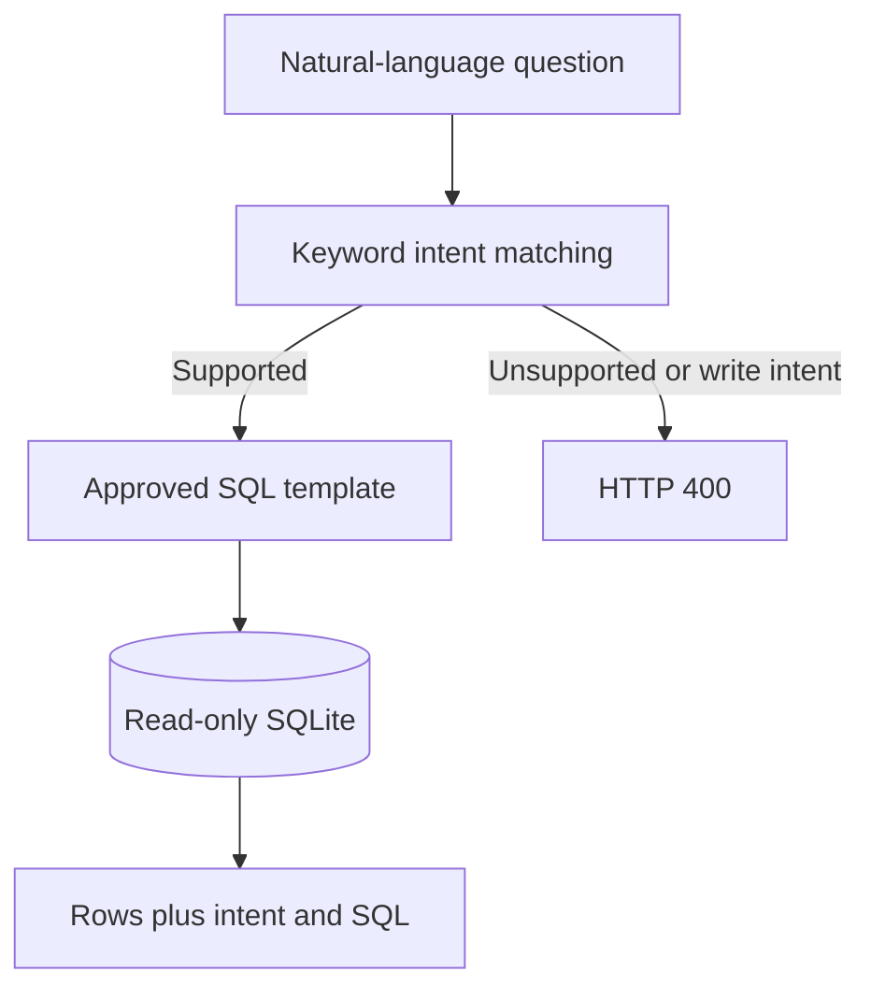

# Natural Language to SQL Analytics Agent

A constrained analytics API that maps a small set of natural-language questions to predefined, read-only SQL templates over a local SQLite sales database.

> **Scope:** This is a keyword/intent-matching prototype, not an LLM-generated SQL agent. It never executes arbitrary SQL supplied by a user.

## Supported intents

- Total sales grouped by region.
- Total sales grouped by product.
- Average sale amount.
- List sales records.

Unsupported questions return HTTP 400 with guidance about the supported question types.

## Safety controls

- Predefined SQL templates only; no user-provided SQL is executed.
- Explicit rejection of common write/DDL terms such as DELETE, DROP, UPDATE, INSERT, ALTER, and TRUNCATE.
- SQLite connection opened in read-only mode for query execution.
- Maximum of 100 returned rows.
- Pydantic request validation with a bounded question length.
- Local synthetic sales data initialized for the demo.

## Request flow



## Quick start

Requirements: Python 3.10+.

```bash
git clone https://github.com/HardikPaghdar/natural-language-to-sql-analytics-agent.git
cd natural-language-to-sql-analytics-agent
python -m venv .venv
source .venv/bin/activate
# Windows: .venv\Scripts\activate
pip install -r requirements.txt
uvicorn app:app --reload
```

Open Swagger UI at http://127.0.0.1:8000/docs.

## Example request

```bash
curl -X POST http://127.0.0.1:8000/query \
  -H "Content-Type: application/json" \
  -d '{"question":"Show total sales by region"}'
```

The response includes the matched intent, approved SQL statement, result rows, row limit, and a `read_only` indicator.

Other endpoints:
- `GET /health` — service status
- `GET /schema` — demo sales table schema
- `POST /query` — execute a supported analytics question

## Sample data

The application initializes a local `sales` table with synthetic region, product, and amount records when the database is empty. It is a demonstration dataset, not business or customer data.

## Tests

```bash
pytest
```

GitHub Actions runs the automated test suite on pushes and pull requests.

## Limitations and production requirements

- Intent matching is keyword-based and supports only a few hard-coded query shapes.
- No schema discovery, join planning, semantic parsing, or LLM is included.
- The sample SQLite database is local to the application.
- Authentication, tenant isolation, row-level permissions, query audit logging, rate limits, and operational monitoring are not implemented.
- Read-only access and a row cap reduce risk but do not replace authorization or database governance.

## Project structure

- `app.py` — FastAPI routes, intent mapping, and SQLite execution
- `tests/test_app.py` — API and query behavior tests
- `.github/workflows/ci.yml` — CI workflow

## Related projects

- [AI Data Quality Monitor](https://github.com/HardikPaghdar/ai-data-quality-monitor)
- [LLM Evaluation & Observability Platform](https://github.com/HardikPaghdar/llm-evaluation-observability-platform)
- [More projects on my portfolio](https://hardikpaghdar.netlify.app/)
